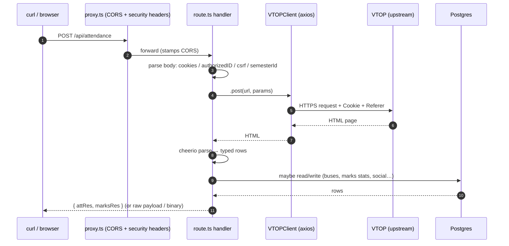

# How a request flows

> **In one line:** proxy.ts stamps CORS headers on everything, the route handler does the work, the response goes out. There is no framework magic in between.

Here is exactly what happens when you POST to `https://api.amazecc.com/api/attendance`:

## Step 1 — The proxy (src/proxy.ts)

Every request to `/api/*` passes through `proxy.ts` first. It does two things and then gets out of the way:

1. **Handles `OPTIONS` preflights** and returns `Access-Control-Allow-*` headers immediately.
2. **Stamps the response headers** on the way back out: open CORS (`Access-Control-Allow-Origin: *`), security headers (`X-Content-Type-Options`, `X-Frame-Options: DENY`, `HSTS`, `Referrer-Policy`, `Permissions-Policy`) and `Access-Control-Expose-Headers` so browsers can read download filenames.

There is no per-route middleware logic. Auth is checked *inside* each route handler, not centrally.
Routing is pure file-system routing from Next.js App Router (`src/app/api/attendance/route.ts` → `/api/attendance`).

## Step 2 — The route handler (src/app/api/attendance/route.ts)

The handler does the actual work, in four phases:

1. **Parse and normalize the body.** `await req.json()` — cookies (string or array — the code joins them), `csrf`, `authorizedID`, `semesterId`.
2. **Call VTOP over HTTP.** `VTOPClient().post(url, params, { headers })` — the thin axios wrapper in `src/lib/clients/VTOPClient.ts`. The request carries `Cookie: <cookies>` and `Referer: https://vtopcc.vit.ac.in/vtop/open/page`.
3. **Parse HTML into typed objects.** cheerio (or the `htmlparser2` twin) picks rows and cells out of the page and maps them to typed arrays (e.g. `attendanceItem[]`).
4. **Fan out if needed, then return the envelope.** Attendance additionally calls each course's detail page (`processViewAttendanceDetail`, concurrency 3) and merges per-date status in before replying.

## Step 3 — The VTOP client (src/lib/clients/VTOPClient.ts)

A single axios instance with 20s timeout, a browsery User-Agent, and a **TLS root-certificate agent** (`viteHttpsAgent()` in `src/lib/vitTls.ts`) that injects the Sectigo intermediate certificate VIT's servers omit. Without it, `vtopcc.vit.ac.in` presents an incomplete chain and axios rejects.

`post()` always adds the same three fields VTOP expects: `verifyMenu=true`, the url-encoded body, and `Cookie` + `Referer` headers. No state is kept client-side; you must send the cookies every time.

## Step 4 — The parsers (src/lib/parsers/ and inline)

Every page scraped is HTML soup. The parsers are the reason the API exists. Three families:

- **Dedicated controllers/parsers** (~17 of them in `ROUTE_TRACKER.md`): attendance, marks, timetable, course page, fees, hostel — hand-written for each page.
- **`parseVtopHtml` auto-parse** (`src/lib/parsers/auto-parse.ts`): a generic fallback that extracts any table, select, key-value pairs or form fields from a page and returns them — good enough to not crash, occasionally good enough to use.
- **htmlparser2 twins** (`*.htmlparser2.ts`): the same parsers built on `parseDocument` + `css-select` instead of cheerio — faster and dependency-lean.

## Step 5 — The database (src/lib/db.ts)

Some endpoints hit our own PostgreSQL (Supabase) alongside or instead of VTOP: bus routes, machine-readable qbank data, the social timetables, the audit log. `getDbPool()` creates a singleton `pg.Pool`. Failures map through `getDbErrorStatus()` (503) and `getDbErrorMessage()` so driver errors never leak, and a circuit breaker ("wait 60s") is logged when VTOP/pool auth fails repeatedly.

## Step 6 — The response

What you get back is either an envelope or a legacy raw shape — check the reference page for the exact route:

- `{ success, ... }` — the modern envelope. Check `success` first.
- `{ attRes, marksRes }` — attendance's legacy raw shape.
- `binary` — syllabus / circulars / papers download with `Content-Disposition` headers.
- `{ status: 'payment_form', html, tcUrl }` — events' payment passthrough.

## The 10-minute session problem

VTOP kills sessions after ~10 minutes of inactivity. The API is stateless: it receives cookies per request and cannot "keep" you alive. The frontend handles this by treating every cold start as suspect and re-logging-in on any auth failure. You should do the same: **if a VTOP route returns anything auth-shaped, call `POST /api/login` again.**

## Where to next

- **[Authentication overview](../01-authentication/index.md)**
- **[The login endpoint, line by line](../02-internals/login-endpoint.md)**
- **[API Reference — Academics & VTOP](../03-api-reference/academics-vtop/index.md)**
