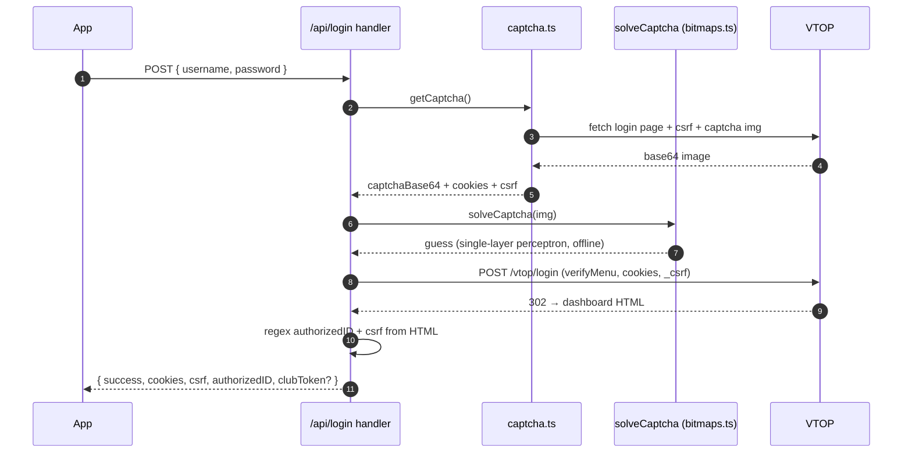

# The login endpoint, line by line

> **In one line:** `/api/login` is the most important file in this repo — the door VTOP mounts its captcha on — and it is built to fail fast and never hang.

Crate-layout: `src/app/api/login/` — `route.ts` (the handler), `captcha.ts` (captcha fetcher), `solveCaptcha.ts` (offline solver), `bitmaps.ts` (411 KB of model weights).



## The handler's skeleton

```ts
export async function POST(req: Request) {
  const ip = getClientIp(req);
  const rl = checkRateLimit(`login:${ip}`, 5, 60000);
  if (!rl.allowed) return rateLimitResponse(rl.retryAfterMs);   // 429 + Retry-After

  const { username, password } = await req.json().catch(() => ({}));

  // --- Phase A: solve the captcha --------------------------------------
  const { captchaBase64, cookies, csrf } = await withDeadline(
    getCaptcha(), 50_000, 'Deadline: captcha phase exceeded',
  );

  const solved = solveCaptcha(captchaBase64);                    // offline perceptron
  // …if the solve is implausible, retry (the solver asks for confidence)

  // --- Phase B: hit VTOP's /vtop/login -----------------------------------
  const res = await VTOPClient().post('/vtop/login', params, {
    maxRedirects: 0,
    timeout: 15_000,
    // cookies + _csrf from Phase A
  });

  // --- Phase C: read the dashboard --------------------------------------
  // Regex the HTML for `authorizedidx` (success marker). If found, then:
  const authorizedID = /* …regex… */;
  const csrfFinal = /* …regex or fallback… */;

  // --- Phase D: club token if applicable ----------------------------------
  const clubs = await lookupClubRepresentatives(authorizedID);
  const clubToken = clubs.length ? signClubToken({ vtop_id: authorizedID, clubs }) : null;

  return NextResponse.json({ success: true, message: 'Login successful', /* … */ });
}
```

## The deadlines (`withDeadline`)

Three budgets, all hard: **VTOP_REQUEST_TIMEOUT_MS = 15s**, **VTOP_PHASE_BUDGET_MS = 50s**, `DB_LOOKUP_BUDGET_MS = 5s`. Anything VTOP not answering in 15 seconds is treated as dead. Anything taking over 50 seconds hits a 504, not a zombie connection. The `DeadlineError` sentinel knows the difference and maps each phase to 502/504 precisely.

## The captcha solver (`solveCaptcha.ts`)

VTOP's captcha is a 6-character alphanumeric (no ambiguous glyphs — no O/0, I/1, 1-ish). The alphabet is exactly `ABCDEFGHJKLMNPQRSTUVWXYZ23456789`. The model is a single-layer perceptron over a bitmap grid: each character is cropped, binarized by global average, matched against trained bitmaps, softmaxed by class. **It is an offline model — no external service is called.** VTOP cannot serve MFA-style reCAPTCHAs to datacenter IPs to this solver, and that is the only reason this endpoint survives on Vercel.

## The dashboard parse

The 302 target page contains `authorizedidx=<value>` in a hidden input when login succeeds. The code regexes for it. It also scans for:

- `invalid captcha` → `{ success: false, message: 'Invalid Captcha' }`
- `invalid (user name|user id|login id)\/password` → `{ success: false, message: 'Invalid Credentials' }`
- `your account will be blocked` / `months` → password-expired family

## The club token fork

After a successful login, `signClubToken` fires only if `club_representatives` has rows for `vtop_id = authorizedID` (deduped by club, `super-club-rep` wins). The frontend consumes `clubToken` to register as the club on first sync. Independent of cookies/csrf.

## Where to next

- **[The VTOP client](./vtop-client.md)** — what those `.post()` calls do.
- **[The parser ecosystem](./parsers.md)** — when the 302 lands and the HTML must become objects.
- **[Quickstart → POST /api/login](../00-start-here/quickstart.md)** — see it yourself.
